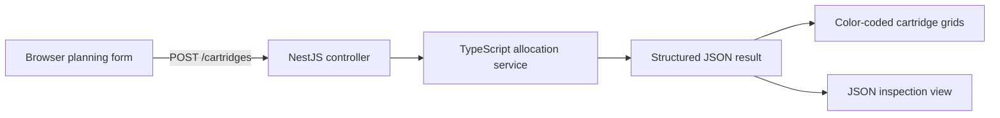

# Cartridges

**A web-based cartridge-layout planner for distributing ligand–analyte interactions across cartridge grids.**

Cartridges helps scientists turn a set of interaction counts and cartridge dimensions into a visual work plan. Enter the number of ligands, the analytes per ligand, and the available cartridge geometry, then generate color-coded grids and a structured JSON result.

The application supports two planning questions: **how many cartridges are needed for a target workload**, and **how the capacity of a known set of cartridges can be distributed among ligands**. The repository contains the original TypeScript/NestJS implementation developed in 2021.

## Features

| Capability | What it provides |
| --- | --- |
| Workload-based planning | Enter ligand and analyte counts with one cartridge geometry and let the service calculate a cartridge count from total interaction capacity. |
| Capacity-based planning | Supply cartridge quantities and dimensions to distribute available capacity among ligands. |
| Multiple cartridge configurations | Add rows of cartridge quantities, row counts, and column counts for a fixed inventory. |
| Visual layouts | Inspect each cartridge as a grid with ligand labels, color coding, and numbered analyte positions. |
| Summary metrics | See the total cartridge count, the reported interaction count, and maximum grid capacity. |
| JSON inspection | Switch between the visual layout and the allocation result without submitting a second calculation. |
| HTTP interface | Submit a structured planning request to `POST /cartridges`. |

The planner calculates layouts in memory. Its scope is allocation and visualization; it does not connect to laboratory instruments or store experimental results.

## Using the planner

1. Enter the number of **Ligands** and **Analytes/Ligand**.
2. Specify cartridge **Rows** and **Cols**.
3. Choose the planning mode through the cartridge quantity:
   - Leave the quantity blank or enter `0` for a single configuration to calculate a cartridge count.
   - Enter positive quantities for a fixed inventory. Use **Add Cartridge** to include additional configurations.
4. Select **Generate**.
5. Review the summary and color-coded **UI** view, or select **JSON** to inspect the calculated allocation.

The initial screen suggests three ligands, 30 analytes per ligand, and a six-row by eight-column cartridge. These are editable inputs.

### Planning modes

| Input | API result mode | Calculation |
| --- | --- | --- |
| One cartridge configuration with quantity `0` | `cartridge` | Uses ligand count × analytes per ligand as the requested workload, calculates a cartridge count, and allocates columns to each ligand. |
| Cartridge configurations with positive quantities | `analytes` | Uses the supplied inventory to calculate capacity per ligand. The entered analyte target does not limit this mode. |

A zero-quantity configuration cannot be combined with additional configurations. Cartridge configurations are sorted by descending row count before allocation.

### Example: three ligands and 30 analytes each

For a single six-row by eight-column configuration with quantity `0`:

- Requested interactions: `3 × 30 = 90`.
- Capacity per cartridge: `6 × 8 = 48`.
- Calculated cartridge count: `ceil(90 / 48) = 2`.
- Maximum interaction capacity: `2 × 48 = 96`.
- Across the 16 available columns, the service assigns six columns to L1 and five each to L2 and L3. The visual layout numbers 30 analyte positions for each ligand.

This example follows the implemented calculation. The algorithm uses a capacity calculation followed by column allocation; it does not establish a globally optimal layout. When partially filled ligand columns are required, the calculated cartridge count needs checking against the actual column requirements.

## How allocation works

The allocation service sorts cartridge configurations, checks the supported zero-quantity rule, and builds an ordered list of ligands named `L1`, `L2`, and so on.

For workload-based planning, it calculates total interactions and rounds up the required number of cartridges using grid capacity. It then assigns each ligand enough columns for the requested analytes and distributes any remaining columns in order.

For a fixed inventory, it walks through the cartridge columns and distributes each column's row capacity among ligands in round-robin order. A second pass converts those capacity targets into contiguous column ranges for display.

The result contains the cartridge configurations, totals, selected mode, and each ligand's column count, analyte count, and inclusive start/end column indexes. The browser uses those ranges to build cartridge tables and number analyte positions vertically within each ligand's allocation.

The allocation logic is in [CartridgesService](src/cartridges/cartridges.service.ts); the grid renderer is in [the Handlebars view](views/index.hbs).

## Architecture and technology



| Layer | Implementation |
| --- | --- |
| Application server | Node.js, NestJS 7, and the Express adapter. |
| Allocation logic | TypeScript service and typed input/result models. |
| Page rendering | Handlebars template served by the root controller. |
| Browser interaction | JavaScript and jQuery for form submission and dynamic grid rendering. |
| Presentation | CSS, ligand-specific colors, and W3.CSS. |
| Development tooling | TypeScript 4.2, ESLint, Prettier, Jest, and Supertest. |

The server renders the initial page, while browser JavaScript handles interactive layout generation from the API response. The controller and service keep HTTP handling separate from allocation calculations.

## HTTP interface

### Generate a plan

Send the following JSON body to `POST /cartridges`:

```json
{
  "ligands": 3,
  "analytes": 30,
  "cartridges": [
    { "count": 0, "rows": 6, "cols": 8 }
  ]
}
```

The response includes:

| Field | Meaning |
| --- | --- |
| `totalCartridges` | Calculated count or total supplied inventory. |
| `uniqueInteractions` | Requested interactions in workload mode; total supplied capacity in fixed-inventory mode. |
| `maxInteractions` | Total cell capacity across the resulting cartridges. |
| `mode` | `cartridge` or `analytes`. |
| `cartridges` | Cartridge quantities and dimensions used by the planner. |
| `ligands` | Per-ligand allocations, including `name`, `cols`, `analytes`, `start`, and `end`. |

The browser uses the POST route. A legacy GET route is also present, but its flat query-parameter checks do not match the nested cartridge input expected by the service.

## Run locally

Install Node.js and npm, then run from the repository root:

```sh
npm install
npm run start:dev
```

Open [http://localhost:3000](http://localhost:3000). The application currently sets port `3000` in [src/main.ts](src/main.ts).

For a compiled run:

```sh
npm run build
npm run start:prod
```

Keep the `views/` directory alongside `dist/`; the application loads its Handlebars template from that location. The page also loads jQuery and W3.CSS from external CDNs.

These commands come from [package.json](package.json). The repository retains its original dependency versions and does not pin a Node.js engine version; current-runtime compatibility has not been established by this documentation update.

## Project structure

```text
src/
  main.ts                         Application bootstrap and view setup
  app.controller.ts               Main page route
  cartridges/
    cartridges.controller.ts      Planning HTTP endpoints
    cartridges.service.ts         Capacity and allocation calculations
    cartridges.module.ts          Feature registration
    models/                       Input, cartridge, ligand, and result types
views/
  index.hbs                       Planning form, grid renderer, and JSON view
test/
  app.e2e-spec.ts                  Original end-to-end test scaffold
```

## Testing and implementation scope

The project includes Jest and Supertest configuration, with scripts for unit tests, coverage, and end-to-end tests. The checked-in test files still contain the original `Hello World!` starter expectations, including a reference to a controller method that is no longer present. They are scaffolding to update, rather than verified coverage of the allocation algorithm.

The implementation is a focused planning prototype. Validation currently checks the zero-quantity configuration rule; broader validation of positive integers, empty inputs, capacity boundaries, and mixed-dimension layouts remains work to complete. No fresh application or test execution is claimed by this README.

The package is marked `UNLICENSED`; no separate license file is included.
